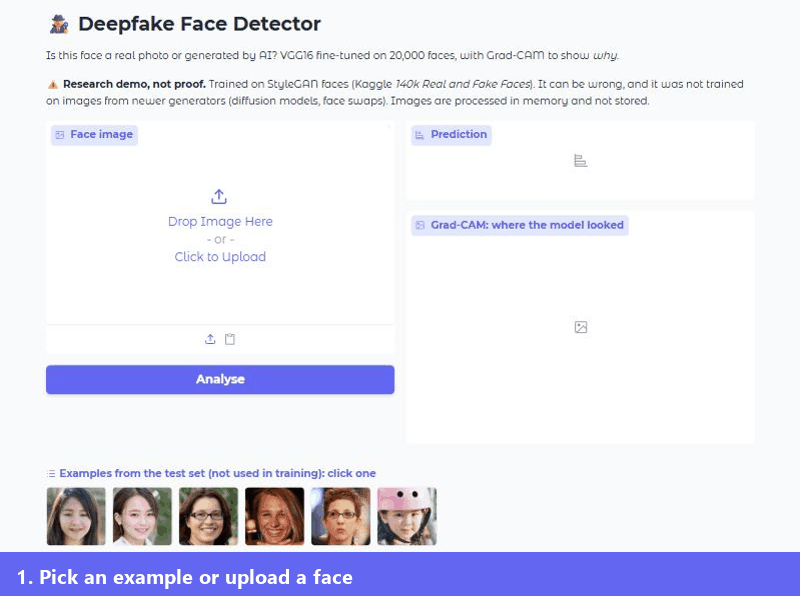
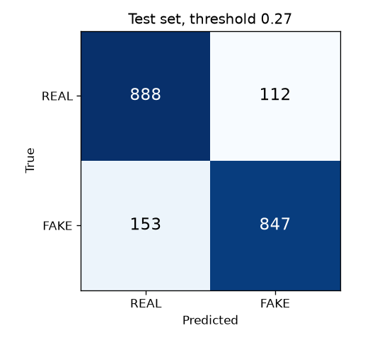
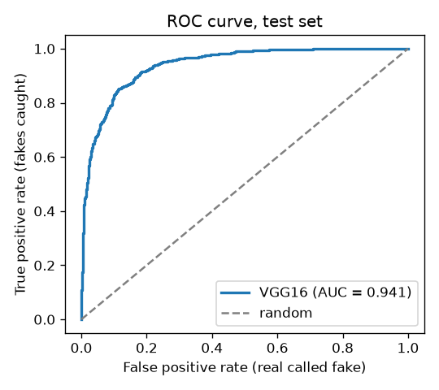
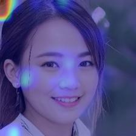
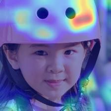

# Deepfake Face Detector


Is this face a real photo or generated by AI? A **VGG16 model fine-tuned on 20,000 faces** classifies the image. **Grad-CAM** then shows which regions drove the decision, in a Gradio web app.



## Results

Test set: 2,000 images never seen in training (balanced). The decision threshold was chosen on a separate validation set, never on the test set ([`scripts/evaluate.py`](scripts/evaluate.py)).

| Metric | Threshold 0.5 | **Threshold 0.27** (tuned on validation) |
|---|---|---|
| Accuracy | 86.0% | **86.8%** |
| Precision (fake) | 82.0% | **88.3%** |
| Recall (fake) | 92.2% | 84.7% |
| F1 (fake) | 86.8% | 86.5% |

**AUC 0.941** · CPU inference ~108 ms per image (batch 32), under 1 s per request in the app including Grad-CAM.

| Confusion matrix (threshold 0.27) | ROC curve |
|---|---|
|  |  |

**Why the threshold isn't 0.5:**
- During training, the fake class was up-weighted (×1.2) to catch more fakes.
- The side effect is a model that is too quick to call a real face fake: at 0.5, about 200 of the 1,000 real test faces were flagged as fake.
- Moving the threshold to 0.27, picked on validation data, brings that down to 112, almost half. The cost is catching a few fewer fakes (recall 92% → 85%). Accuracy goes from 86.0% to 86.8%, which is within the margin of error on 2,000 images, so the real gain is fewer false accusations.

## How it works

```
image ─► resize 224×224 ─► VGG16 (ImageNet weights, block4+5 fine-tuned) ─► GAP ─► Dense 512 ─► Dense 128 ─► sigmoid = P(real)
                                  │
                                  └─ block5_conv3 feature maps ─► Grad-CAM heatmap (gradient of the logit for the predicted class)
```

- **Data:** balanced random subset of [140k Real and Fake Faces](https://www.kaggle.com/datasets/xhlulu/140k-real-and-fake-faces): 10k real + 10k fake (StyleGAN) for training, 2k + 2k for validation.
- **Model** ([`training/train.py`](training/train.py)):
  - Transfer learning from VGG16, with the last two conv blocks fine-tuned.
  - The head uses BatchNorm and L2 regularisation, no dropout.
  - Training used Adam (1e-4), early stopping on validation AUC, and LR reduction on plateau.
  - Training curves are in [`docs/training_history.png`](docs/training_history.png).
- **Grad-CAM** ([`detector.py`](detector.py)):
  - Each of the 512 feature maps of the last conv layer is weighted by the gradient of the class score, then summed.
  - The gradient is taken on the **logit**, not the sigmoid output. On very confident images the sigmoid is flat, so its gradients vanish and the heatmap comes out empty.

## What Grad-CAM revealed (limitations)

| Fake, 96% confident | Real, 100% confident |
|---|---|
|  |  |

- **Fakes:** the model often looks at **image corners, background and hair edges**, not the facial features. StyleGAN is known for artifacts in those areas. It also means the model may rely on generator-specific traces rather than understanding faces.
- **Other generators:** it was trained only on StyleGAN faces, so it is **not** reliable on images from newer generators (diffusion models, face swaps, edited photos). Testing on those would be the next step.
- **Image format:** it works on aligned, square face crops like the dataset's. Full photos with small faces will give poor results.
- **Not proof:** a detector like this is a hint, not evidence. The app shows a disclaimer.
- **Confidence:** the percentage is the model's output rescaled around the threshold, not a calibrated probability.
- **Known miss:** the example `real_1.jpg` is a real face the model calls FAKE (63%). It stays in the demo on purpose: at about 87% accuracy, the model does make mistakes.

## Run it

Needs **Python 3.11**: TensorFlow 2.15 has no build for Python 3.12 or newer.

```bash
git clone https://github.com/FAROUK-debug/deepfake-detector.git
cd deepfake-detector
py -3.11 -m venv .venv            # macOS/Linux: python3.11 -m venv .venv
.venv\Scripts\activate            # macOS/Linux: source .venv/bin/activate
pip install -r requirements.txt
python app.py                     # http://127.0.0.1:7860
```

The trained model (167 MB) is downloaded automatically from this repo's [GitHub release](https://github.com/FAROUK-debug/deepfake-detector/releases) on first run. Its SHA-256 is checked before loading.

Re-run the evaluation or the training (needs the [Kaggle dataset](https://www.kaggle.com/datasets/xhlulu/140k-real-and-fake-faces)):

```bash
python scripts/evaluate.py --data path/to/real-vs-fake
python training/train.py   --data path/to/real-vs-fake      # GPU strongly recommended
```

Tests (`pytest`) run in GitHub Actions, including prediction and Grad-CAM on the real model.

## Security and privacy

- **Uploads:**
  - Images are processed in memory and nothing is stored.
  - Uploads are capped at 5 MB, and images above 25 megapixels are refused (decompression-bomb protection).
  - Images under 64 px are rejected.
- **Server:** it listens on `127.0.0.1` by default.
- **Model file:** it's checked against a fixed SHA-256 before it's loaded. A Keras `.h5` file can contain code, so only the expected file is accepted.

## Project layout

```
app.py              Gradio interface
detector.py         model loading, prediction, threshold, Grad-CAM, overlay
training/train.py   how the model was trained
scripts/evaluate.py threshold tuning (validation) + test metrics and plots
examples/           6 test-set images (3 real, 3 fake) used as demo examples
docs/               results, plots, training logs, screenshots
tests/              pytest suite
```

## Tech

Python · TensorFlow / Keras · VGG16 transfer learning · Grad-CAM · Gradio · scikit-learn · Matplotlib · pytest · GitHub Actions
